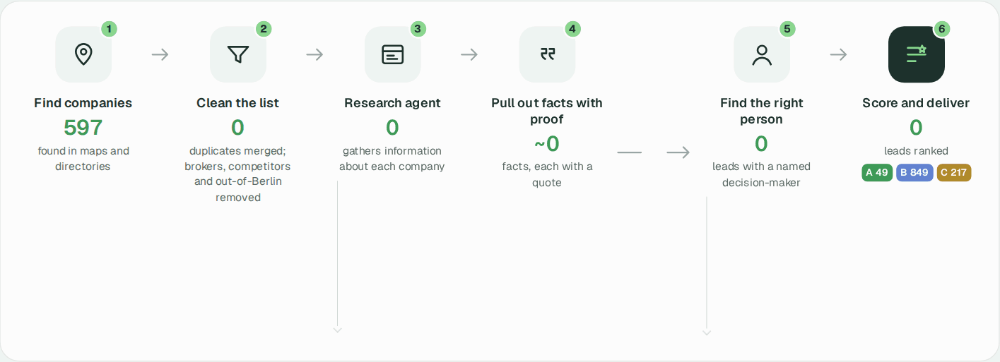

# Berlin property-manager leads for Heidi Systems

An AI agent pipeline that turns public sources into a ranked, reachable lead list of Berlin property
managers and housing companies, with a source quote behind every fact.



Dashboard: [case-study-dashboard](https://github.com/apzl/case-study-dashboard)

## Requirements

- Python 3.12
- [Claude Code](https://docs.anthropic.com/en/docs/claude-code), installed and logged in (`claude`, then `/login`); model calls run through the Claude Agent SDK
- Google Maps API key with Places API (New) enabled, for map discovery
- Optional, for PDFs: Poppler (`pdftotext`), Tesseract (deu, eng), OCRmyPDF

## Setup

```bash
git clone https://github.com/apzl/case-study.git && cd case-study
python3.12 -m venv .venv && source .venv/bin/activate
pip install -r requirements.txt
playwright install chromium
cp google_places.env.example google_places.env    # set GOOGLE_MAPS_API_KEY
```

## Run

```bash
# Full run: discovery, dedup, crawl, website search, extraction, scoring, contact step
python -m heidi_leads.run_full --source both

# Build the workbook and CSVs from the database (no network or model calls)
python -m heidi_leads.pipeline export

# Optional
python -m heidi_leads.job_ads search && python -m heidi_leads.job_ads contacts   # hiring signal
python -m heidi_leads.dashboard_data             # dashboard data (full, local)
python -m heidi_leads.dashboard_data --public    # redacted copy into ../case-study-dashboard
```

Runs are resumable: an interrupted run continues where it stopped. Every step on its own:
[docs/usage.md](docs/usage.md).

## Outputs

| Path | Content |
|---|---|
| `output/Heidi_Berlin_Pilot.xlsx` | Sales workbook: Leads (tiers A–C), Contacts, Evidence, Details, Guide |
| `output/companies.csv`, `details.csv`, `evidence.csv` | Same tables as CSV |
| `output/run-report.json` | Counts per step and fact yield |
| `data/leads.sqlite`, `data/snapshots/` | Database and saved source pages |

Contact data stays local: `data/`, `output/` and `runs/` are git-ignored.

## Project layout

```
heidi_leads/
  run_full.py            orchestrates a full run in resumable batches
  discover_maps.py       Google Places + OpenStreetMap discovery
  discover_directories.py  association directories (BBU, WBGD, BVI, state-owned)
  dedup.py               merge duplicates (domain, phone, name + postcode)
  collect.py             crawler (Scrapy, Playwright fallback, PDF text/OCR)
  search_sources.py      web search for firms without a website
  pipeline.py            CLI: discover, collect, enrich (Claude extraction), export, evaluate
  rules.py               extraction field guide
  core.py                database, fact checks, scoring, contact routing, opener
  find_contacts.py       contact step (LinkedIn, team pages)
  job_ads.py             LinkedIn public job ads
  workbook.py            sales workbook layout
  dashboard_data.py      dashboard data (full and redacted)
tests/                   offline tests (model calls faked)
docs/                    design notes, results, usage, architecture, deck
```

## Configuration

| Variable | Default | Purpose |
|---|---|---|
| `GOOGLE_MAPS_API_KEY` | read from `google_places.env` | Google Places discovery |
| `HEIDI_EXTRACT_MODEL` | `claude-haiku-5-5` | model for fact extraction |
| `HEIDI_EFFORT` | `low` | effort level for extraction calls |
| `HEIDI_DASHBOARD_DIR` | `../case-study-dashboard` | where `dashboard_data --public` writes |

## Tests

```bash
python -m pytest -q
```

## Cost

About $0.09 per lead on the Berlin run: $0.018 per company for extraction, $0.043 per website
search, $0.05 per lead for the contact step. Discovery, scoring and exports are free.
Details: [docs/architecture.md](docs/architecture.md).
