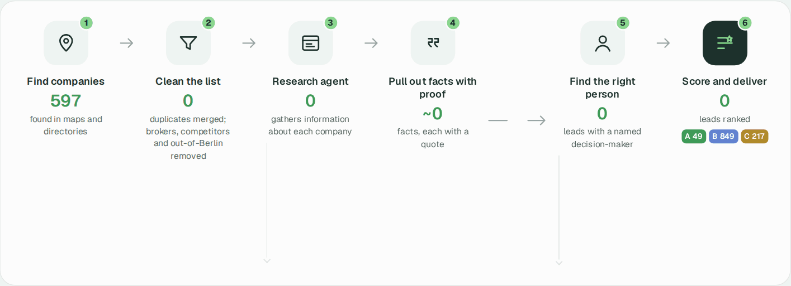

# Architecture



## The idea in one paragraph

Every company goes on a short journey: it is **found** on a map or in a directory, **researched** by
reading its own website, turned into **facts with proof** (each fact quotes the page it came from),
**scored** for fit and reachability, and **enriched** with the right person to call. Everything lands
in one local database, and the sales workbook and dashboard are rebuilt from it at any time.

## The six moves

| Move | What happens | Where in the code |
|---|---|---|
| 1. Find | Google Places and OpenStreetMap search across Berlin; association directories add members | `discover_maps.py`, `discover_directories.py` |
| 2. Clean | Merge duplicates (same website, phone, or name + postcode); set brokers and competitors aside | `dedup.py`, `pipeline.py` |
| 3. Research | Crawl each company's own pages (legal notice, team, contact, services, PDFs); search the web for firms without a site | `collect.py`, `search_sources.py` |
| 4. Facts with proof | Claude (Agent SDK) reads the saved pages and returns typed facts, each with a quote; code checks every quote, number and phone against the page | `pipeline.py`, `rules.py`, `core.py` |
| 5. Find the person | Search LinkedIn and team pages for named staff; read public job ads for hiring and contacts | `find_contacts.py`, `job_ads.py` |
| 6. Score and deliver | Fit and reach scores, tiers, a tailored opener; Excel workbook and dashboard data | `core.py`, `workbook.py`, `dashboard_data.py` |

`run_full.py` runs moves 1–5 in resumable batches; job ads and dashboard data run on their own.

## Where things live

```
data/leads.sqlite        one database: companies, saved pages, facts with quotes
data/snapshots/          the raw pages, so every fact can be traced back
        │
        ▼  python -m heidi_leads.pipeline export
output/Heidi_Berlin_Pilot.xlsx      the sales workbook
output/*.csv                        the same tables as CSV
        │
        ▼  python -m heidi_leads.dashboard_data
output/dashboard/data.js            full dashboard data (local)
```

| Output | What's inside |
|---|---|
| `output/Heidi_Berlin_Pilot.xlsx` | Leads (the call list, tiers A–C), Contacts, Evidence, Details (all companies), Guide |
| `output/companies.csv`, `details.csv`, `evidence.csv` | The same tables for other tools |
| `output/run-report.json` | Counts per step and how often each fact was found |
| `output/dashboard/data.js` | Data for the dashboard, with named contacts |
| Dashboard repository `data.js` | Redacted copy for public hosting (`dashboard_data --public`) |

## What it costs

About **$0.09 per lead** for the whole Berlin run. Reading a company's pages costs about $0.018,
searching for a missing website about $0.043, finding the right person about $0.05 per lead.
Discovery, scoring and exports are free.

## Data protection

Only business information is collected: company names, listed phones, office addresses and
professional contacts that companies publish themselves. Anything that names a person (database,
workbook, CSVs, logs) stays on your machine and out of git. The public dashboard data drops people,
direct lines, personal e-mails, LinkedIn profiles and quotes that name a person. Outreach with the
contact data needs its own legal basis (B2B, legitimate interest) and an opt-out.

## Limits

- Few companies publish meter, billing or contract details, so those signals are rare.
- LinkedIn results often lack job titles; personal e-mails are rarely public.
- Google Places caps results per search; directories change their pages over time.
- Berlin-specific: postcodes, districts and search terms are set for Berlin.
